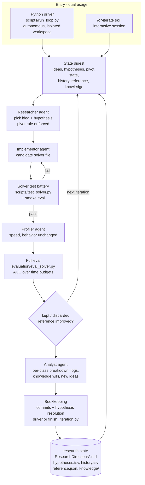

# or-autoresearch

A general MIP autoresearch loop for community reuse: an autonomous LLM research
loop that improves solvers for optimization problems on a seeded, reproducible
benchmark - measuring objective quality at each timeout. First problem: the
0-1 multidimensional knapsack (MDKP). Structure and evaluation logic descend
from `meta_autoresearch_light` (the TSP prototype); the loop protocol is
redesigned around user/LLM research ideas, a hypotheses log, named agents,
and exploration hyperparameters.



## Quickstart

```bash
uv sync                                                        # numpy + highspy + pytest
uv run pytest                                                  # framework + problem tests
uv run python -m problems.mdkp.generator                       # writes 10 benchmark instances
uv run python scripts/run_reference.py --problem mdkp --subset full --budgets 1,5,20,60
uv run python scripts/test_solver.py --problem mdkp \
    --solver problems/mdkp/candidates/example_random.py --full  # solver test battery
uv run python evaluation/eval_solver.py --problem mdkp \
    --solver problems/mdkp/candidates/example_random.py --subset smoke
```

Run the loop:

- **Autonomous**: `uv run python scripts/run_loop.py` (config in `loop.json`;
  needs `.env` with `ANTHROPIC_*` keys - see `.env.example`; `claude` CLI on
  PATH). It assembles an isolated workspace under `loop_runs/`, drives one
  headless session per iteration with a generated digest, enforces hard caps,
  and commits bookkeeping. `--dry-run` / `--assemble-only` / `--workspace` to
  resume.
- **Interactive**: in a Claude Code session (ideally on a branch), invoke
  `/or-iterate` - the session becomes the Orchestrator for one iteration and
  runs bookkeeping via `scripts/finish_iteration.py`.

## Architecture

| Piece | Path | What it is |
|---|---|---|
| Framework | `autoresearch/` | harness (fresh subprocess per instance x budget, kill at 1.25x, solver-log capture), scoring (sense-aware AUC + scorer registry), reference.json, history.tsv, hypotheses.tsv + pivot state, solver battery, digest, bookkeeping |
| Eval CLI | `evaluation/eval_solver.py` | the single evaluation entry (scores, updates reference, appends history, resolves hypotheses) |
| Problem packages | `problems/<name>/` | schema, seeded generator, evaluator, benchmark config, baselines, candidates, research state |
| Driver | `scripts/run_loop.py` + `loop.json` | autonomous mode, hyperparameters, workspace isolation, user-idea sync |
| Agents | `.claude/agents/` | implementor, profiler, analyst, researcher (the Orchestrator is the session itself) |
| Skill | `.claude/skills/or-iterate/` | interactive mode |

## Scoring

Per (instance, time budget): `0.0` if no feasible solution, else the ratio to
the best-known objective (`objective / reference_best` for maximization).
Mean across instances per budget; the mean across budgets is the AUC - i.e.
objective quality measured at each timeout, against a reference anchored with
stronger budgets. Pluggable: `--scorer <name>` selects from the registry in
`autoresearch/scoring.py`; problems can self-register scorers in
`problems/<p>/scorers.py`.

## Research state

- `problems/<p>/research/ResearchDirectionsUser.md` - your ideas (`## U1:`),
  read fresh every iteration; agents never write it.
- `problems/<p>/research/ResearchDirectionsLLM.md` - agent ideas (`## L1:`);
  combining ideas adds a new heading referencing its sources
  (`## L7 (=U2+L3): ...`).
- `problems/<p>/research/hypotheses.tsv` - every hypothesis chosen for
  experimentation: id, idea ref, type (user|llm), candidate,
  `proposed -> running -> kept | discarded`, score, rationale.
- `problems/<p>/research/knowledge/` - the Analyst's wiki of learnings.

Loop hyperparameters live in `loop.json`: `idea_pivot_n` (default 3 -
consecutive discarded hypotheses under one idea force a pivot; a kept result
resets), `max_hypotheses_per_idea`, `new_idea_every_n`, `plateau_window`,
plus driver caps. The pivot rule is enforced deterministically by the driver
(and rendered in the digest); the rest are digest nudges.

## Candidates

A candidate is ONE file defining `solve(instance, time_budget_s) -> Solution`.
Any algorithm is allowed - MIP is not required; HiGHS (`highspy`) is available
but optional. Fixed seeds only, deterministic given (instance, budget), the
time budget is a cap. Quick feedback: `scripts/test_solver.py --problem <p>
--solver <file> [--full]` (contract, feasibility, determinism, budget
respect, objective bounds).

## Adding a problem

```bash
uv run python scripts/new_problem.py --name binpacking
```

Implement the five files under `problems/binpacking/` (see
`problems/_template/README.md`): `problem.py` (Instance/Solution with JSON
round-trip + aliases), `generator.py` (seeded, feasible by construction),
`evaluator.py` (feasibility + objective), `benchmark_config.py`
(INSTANCE_CLASSES / TIME_BUDGETS / SUBSETS with a tiny smoke set, plus `SENSE`
and optional `SCORER`), and `solvers/` (a strong anchor + an always-feasible
constructive baseline). Optional hooks: `bounds.py` (bound for the battery's
`--full` check) and `scorers.py` (custom scorers). Then generate instances,
build the reference, and point `loop.json`'s `"problem"` at it.

## Conventions

uv only (never pip), conventional commits (`feat:`/`fix:`/`refactor:`/`docs:`/`chore:`),
tests via `uv run pytest`, no emojis, benchmark instances are read-only.
